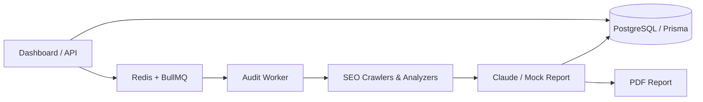

# SEO Automation Dashboard

## Overview

A dashboard for managing clients and websites, running SEO audits, and reviewing scores, findings, recommendations, and PDF reports. Admins manage audits; client users can view their own results.

## Live Demo

[https://seo-dashboard-flame-five.vercel.app/](https://seo-dashboard-flame-five.vercel.app/)

## Architecture / Audit Flow



Audit lifecycle: `QUEUED → PROCESSING → COMPLETED / FAILED`.

## Tech Stack

- Next.js 14 App Router and Node.js
- Tailwind CSS and shadcn/ui-inspired Button and Card primitives
- Prisma and PostgreSQL
- Redis-compatible connection and BullMQ (`seo-audit-jobs`)
- Fetch and Cheerio
- Anthropic Claude API with a `USE_MOCKS` report path
- Puppeteer PDF generation

## Key Features

- Client and website management, admin/client portals, and audit history.
- SEO checks for titles, descriptions, headings, canonicals, image alt text, links, robots.txt, sitemaps, and basic JSON-LD/Schema.org validity.
- Lightweight content checks based on approximate visible text word count and paragraph/heading structure; identifies thin or nearly empty pages.
- PageSpeed, Google Search Console, and DataForSEO signals; Claude or mock report generation.
- Persisted audit scores, issues, recommendations, and downloadable PDF reports.

## Project Structure

- `src/app` — pages and API routes
- `src/services` — audit and report logic
- `src/crawlers` / `src/analyzers` — data collection and SEO analysis
- `src/queues` / `src/workers` — background audit processing
- `src/mocks` — mock provider data and notifications
- `prisma` — schema and migrations
- `tests` — automated tests

## Local Setup

Requires Node.js 20.6 or newer, PostgreSQL, and Redis.

```bash
git clone https://github.com/Samiksha-Lone/seo-dashboard.git
cd seo-dashboard
npm ci
cp .env.example .env
```

Set `DATABASE_URL` and `REDIS_URL` in `.env`, then run:

```bash
npx prisma migrate deploy
npm run db:generate
npm run db:seed-admin
```

Set `INITIAL_ADMIN_EMAIL` and `INITIAL_ADMIN_PASSWORD` before seeding. Run the app and worker in separate terminals:

```bash
npm run dev
npm run worker
```

Open `http://localhost:3000`. See [`.env.example`](./.env.example) for the environment variable reference.

## Environment Variables

Use [`.env.example`](./.env.example) as the authoritative reference. The main settings are:

| Purpose | Variables |
|---|---|
| Database and queue | `DATABASE_URL`, `REDIS_URL` |
| Mock or Claude reports | `USE_MOCKS`, `ANTHROPIC_API_KEY` |
| Initial administrator | `INITIAL_ADMIN_EMAIL`, `INITIAL_ADMIN_PASSWORD` |
| Cron authentication | `CRON_SECRET` |
| Production PDF storage | `SUPABASE_URL`, `SUPABASE_SECRET_KEY` |

## Mock Mode

With `USE_MOCKS=true`, report generation uses the mock path, and PageSpeed, Google Search Console, and DataForSEO use bundled mock data. Claude uses the Anthropic API when `USE_MOCKS=false` and `ANTHROPIC_API_KEY` is configured. Website crawling and robots.txt/sitemap checks make live HTTP requests. Email and WhatsApp notifications are simulated.

## Testing

```bash
npm test
npm run lint
npm run build
```

Tests cover the audit pipeline, reports, and canonical URL and content analysis.

## Demo Access

Administrator credentials are provided separately with the assessment submission. Demo credentials and other sensitive values are not included in this repository.

## Deployment

The application is deployed on Vercel, and its core audit flow has been tested in production. Audits are persisted in PostgreSQL, queued through Redis/BullMQ, and processed through an authenticated cron endpoint. PDF generation and authenticated downloads are supported; production PDF storage requires the configured Supabase Storage credentials. cron-job.org can trigger audit processing.

## Contact

**Samiksha Lone**

- Portfolio: [samiksha-lone.vercel.app](https://samiksha-lone.vercel.app)
