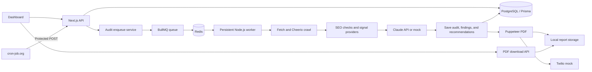

# SEO Automation Dashboard

A Next.js dashboard for managing clients and websites, queueing SEO audits, reviewing saved results, and downloading audit PDFs. Audit processing runs asynchronously in a separate Node.js worker.

## Features

- Database-backed dashboard statistics and recent audit links.
- Client and website management, including create, edit, detail, and safe deletion.
- Audit creation for registered websites, filtered history, detail reports, and status polling.
- Page-level website crawling with Node.js Fetch and Cheerio.
- On-page checks, Schema.org JSON-LD validation, and `robots.txt`/sitemap checks.
- Claude report generation with mock and Anthropic API modes; structured findings, scores, and recommendations are validated before saving.
- BullMQ/Redis queue, PostgreSQL/Prisma persistence, and a persistent audit worker.
- Puppeteer PDF generation and download from audit details.
- Mock PageSpeed, Google Search Console (GSC), DataForSEO, and Twilio WhatsApp integrations.
- Protected monthly-audit scheduling endpoint for an externally configured cron-job.org schedule.

## Tech stack

- Next.js 14 App Router, React 18, and Tailwind CSS.
- Node.js 22.12 or newer, npm, BullMQ 6, and Redis (Upstash supported).
- PostgreSQL (Supabase or Neon supported) and Prisma 6.
- Fetch and Cheerio for website crawling.
- Anthropic JavaScript SDK with `claude-sonnet-4-6`.
- Puppeteer for PDF rendering.
- Vercel can host the Next.js application; the worker needs a separate persistent Node.js host.

See `package.json` and `package-lock.json` for the installed package versions.

## How it works



The dashboard submits an audit through the API. The existing enqueue service creates or reuses the audit and adds a BullMQ job to Redis; it does not run the audit in the web request. The separate worker marks the audit as processing, crawls the website, runs on-page, schema, robots/sitemap and provider-signal checks, generates and validates a Claude or mock report, then saves the audit, scores, issues, and recommendations to PostgreSQL. It generates and stores a PDF, saves report metadata, triggers the Twilio mock, and marks the audit complete. Failures are recorded and rethrown for the queue's retry policy.

PageSpeed, GSC, and DataForSEO return mock data; they are not live provider integrations. The website crawl and robots/sitemap checks do make requests to the registered website. Twilio is also a mock and sends no messages.

## Project setup and installation

Requirements: Node.js 22.12 or newer, npm, PostgreSQL, and Redis. An Anthropic API key is needed only for real Claude mode.

```bash
git clone <repository-url>
cd seo-dashboard
npm ci
```

Copy `.env.example` to `.env`, then set your own PostgreSQL and Redis URLs. Mock mode is enabled by default and does not need an Anthropic API key.

```powershell
Copy-Item .env.example .env
```

On macOS/Linux, use `cp .env.example .env`.

Generate Prisma Client and apply the migrations:

```bash
npm run db:generate
npx prisma migrate deploy
```

Check `DATABASE_URL` before applying migrations. Do not reset a database containing data.

## Environment variables

`.env.example` contains placeholders, not usable credentials. `.env` is ignored by Git.

| Variable | Required | Purpose |
|---|---|---|
| `DATABASE_URL` | Yes | PostgreSQL connection for Prisma, the application, and worker. Use a connection URL from Supabase, Neon, or another PostgreSQL host. |
| `REDIS_URL` | For enqueueing and the worker | Redis connection for BullMQ. Use the TLS URL from Upstash when required. |
| `USE_MOCKS` | Recommended | `USE_MOCKS=true` uses mock Claude and PageSpeed/GSC/DataForSEO signals. `USE_MOCKS=false` selects the Anthropic API; PageSpeed/GSC/DataForSEO live integrations are not implemented. |
| `ANTHROPIC_API_KEY` | Only when `USE_MOCKS=false` | API key for real Claude report generation. Leave unset in mock mode. |
| `REPORT_STORAGE_DIR` | Optional | Absolute directory for PDFs, shared by the web app and worker. Empty/unset defaults to `.local-reports` under the project working directory. |
| `CRON_SECRET` | Only for monthly scheduling | Strong random secret expected as a Bearer token by the monthly audit endpoint. |
| `NODE_ENV` | Set by the runtime | Next.js uses this to select development or production configuration; normally the npm scripts manage it. |

Generate a cron secret locally with:

```bash
node -e "console.log(require('node:crypto').randomBytes(32).toString('hex'))"
```

## Running the application and worker

Start the dashboard and worker in separate terminals, from the project directory:

```bash
npm run dev
```

```bash
npm run worker
```

For automatic worker restarts during development, use `npm run worker:dev`. For a production build, run `npm run build` and then `npm run start`; keep `npm run worker` running separately.

## API and integrations

| Method and endpoint | Description |
|---|---|
| `GET /api/health` | Checks the PostgreSQL connection. |
| `GET /api/dashboard/stats` | Returns dashboard counts and average score. |
| `GET /api/dashboard/audits` | Returns recent audits for the overview. |
| `GET, POST /api/clients` | List clients or create one (`businessName`, `businessType`, `city`, `state`, optional `phone`). |
| `GET, PATCH, DELETE /api/clients/{clientId}` | Read, update, or safely delete a client. Deletion is blocked while websites are associated. |
| `GET, POST /api/websites` | List or create a website (`name`, HTTP/HTTPS `url`, `clientId`). Duplicate normalized URLs are rejected. |
| `GET, PATCH, DELETE /api/websites/{websiteId}` | Read, update, or safely delete a website. Deletion is blocked when audit history exists. |
| `GET /api/audits/websites` | Lists registered websites and clients for audit selection. |
| `GET /api/audits?status=&limit=&offset=` | Lists newest audits; supports status filtering and pagination. |
| `POST /api/audits` | Enqueues an audit from `{ "url": "...", "clientId": "..." }`; returns HTTP 202 on success. |
| `GET /api/audits/{auditId}` | Returns saved status, scores, summary, issues, recommendations, and report metadata. |
| `GET /api/audits/{auditId}/report` | Downloads the generated PDF. |
| `POST /api/cron/monthly-audits` | Queues audits for eligible websites that have no audit in the current UTC month. |

The cron endpoint requires `Authorization: Bearer <CRON_SECRET>`. It checks all audit statuses, including failed audits, to prevent a repeated request from scheduling a second audit for the same website in the same UTC month. The endpoint enqueues jobs; it does not execute the worker.

## Testing

Tests use Node's built-in test runner and controlled doubles where database or external services are unavailable.

```bash
npm test
npm run lint
npx prisma validate
npx next build
```

`npm run build` is the production build script and runs `prisma generate` first. A local build or test run does not verify live PostgreSQL, Redis, Anthropic, or provider connectivity.

## Deployment notes and current limitations

- Deploy the Next.js application to Vercel or another Node.js web host. Configure `DATABASE_URL`, `REDIS_URL`, and other required environment variables in the deployment environment.
- Run the BullMQ worker separately on a persistent Node.js host with access to the same PostgreSQL database and Redis queue. A normal Vercel serverless function is not a persistent worker.
- PDFs are stored on the local filesystem, by default in `.local-reports/`. For separate web and worker hosts, configure `REPORT_STORAGE_DIR` to a shared mounted directory. Local files are not durable production object storage; no R2 integration is configured.
- The monthly cron API is implemented, but no recurring cron-job.org job is provisioned. Configure one manually with method `POST`, URL `https://<deployed-app-host>/api/cron/monthly-audits`, header `Authorization: Bearer <CRON_SECRET>`, and a schedule for the first day of each month at 00:00 UTC. Keep the worker running separately to process the queued audits.
- Authentication and authorization are not implemented. The dashboard and management/audit APIs are not protected; the cron endpoint's secret does not protect the rest of the application.
- There is no dedicated Reports listing page; PDFs are available from audit details.
- PageSpeed, GSC, DataForSEO, and Twilio remain mock integrations. Real Claude report generation is available when configured with an Anthropic API key.
- Production monitoring and live deployment integrations have not been verified.
